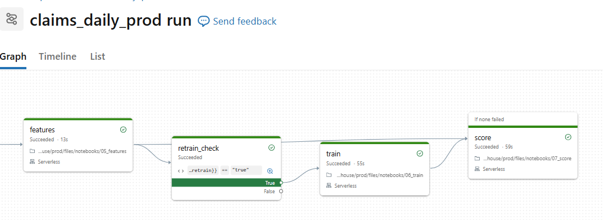

# claims-streaming-lakehouse

Near real-time auto insurance claims lakehouse on Databricks. Claim events arrive as files from two channels, get ingested incrementally, deduplicated and joined to the policy version that was in force when the claim was reported. A fraud model trained with MLflow scores every adjusted claim, and the whole chain runs as one Databricks Job deployed with Asset Bundles from GitHub Actions.

The insurer, policies and claims are synthetic. src/generator.py builds six months of data (January to June 2026) with a fixed seed, so every number below can be reproduced.

## Data

| Source | Format | Rows |
|---|---|---|
| Claim events from the mobile app | JSON | 18,227 |
| Claim events from the third-party administrator | Avro | 7,563 |
| Policy changes (CDC: insert, update, delete) | JSON | 9,674 |
| Fraud investigations | Parquet | 689 |
| Workshops | ORC | 240 |
| Coverages | Parquet | 9 |

The generator plants a few things on purpose: about 1% duplicated events, about 4% of events arriving one to three days late, a new channel column that only shows up from April 1, a hailstorm in Mexico City on April 22 with 1,200 claims in six hours, and a fraud ring of 220 claims routed through 8 workshops in Guadalajara on policies less than 60 days old.

## Pipeline

Bronze (notebooks/02_bronze.ipynb). Auto Loader reads JSON, Avro and Parquet with schema inference and schema evolution, plus COPY INTO for the two small catalogs. When the channel column appeared in April the JSON stream stopped with UNKNOWN_FIELD_EXCEPTION, updated its schema and picked up the new column on the next run.

Policies (src/pipeline/policies.sql). A declarative pipeline applies the CDC feed with AUTO CDC as SCD type 2, with expectations that fail on an unknown operation, drop rows without a policy id and warn on non-positive premiums. Result: 9,029 versions for 8,000 policies, 7,798 current. Endorsements that changed nothing did not open a new version.

Claim events (notebooks/03_silver_events.ipynb). Structured Streaming unions both channels, drops duplicates within a 3-day watermark and joins each event to the policy version valid at event time. 25,536 unique events remain, 648 of them without a policy in force. A second stream counts first notices of loss per city per hour; the hailstorm shows up as the top hours for Mexico City.

Gold (notebooks/04_gold.ipynb). Star schema with dim_date, dim_policy (SCD2 with a surrogate key per version), dim_workshop, dim_coverage and fact_claim at claim grain: 6,901 claims, each linked to the policy version in force when it was reported.

## Fraud model

notebooks/05_features.ipynb builds ml.claim_features, a feature table in Unity Catalog keyed by claim_id. Rolling features only look backwards (90 days by cause, 30 days by workshop, excluding the current claim) to avoid leakage.

| Feature | Fraud | Legit |
|---|---|---|
| Policy age (days) | 47.1 | 220.4 |
| Estimate vs cause average | 2.105 | 0.970 |
| Workshop claims in last 30 days | 8.904 | 5.564 |
| Share of new policies at the workshop | 0.562 | 0.169 |

notebooks/06_train.ipynb trains two models on the investigated claims (70/30 stratified split) and registers both in Unity Catalog. The one with the best PR-AUC gets the champion alias and the other one the challenger alias.

| Model | PR-AUC | ROC-AUC | Precision | Recall |
|---|---|---|---|---|
| Gradient boosting (champion) | 0.974 | 0.976 | 0.927 | 0.944 |
| Logistic regression (challenger) | 0.963 | 0.987 | 0.945 | 0.963 |

notebooks/07_score.ipynb scores every adjusted claim with the champion. 343 of 6,792 claims are flagged; 236 of them are in Guadalajara, against 6 to 40 in every other city.

## Performance and cost

notebooks/08_optimize.ipynb. Streaming writes are compacted automatically after each update (one 507 KB file for silver events). To measure clustering, silver events were copied 400 times (10.2 million rows) in random order. After CLUSTER BY (event_ts, city) and OPTIMIZE FULL, a one-week payments query read 12.09 MB instead of 40.50 MB (70% less) with the same result. Cost is tracked from system.billing.usage by product.

## Orchestration and deployment

The job claims_daily runs generate, bronze, the policies pipeline, silver events, gold and features in sequence. A condition task checks the retrain parameter: when it is true the model is retrained before scoring, otherwise scoring uses the current champion. Scoring runs with "if none failed" so it also works when training is skipped.

GitHub Actions runs the generator tests on every push and pull request, and deploys the bundle to the prod target on every push to main. The dev target uses the claims_dev catalog and prod uses claims; a full prod run reproduced the dev numbers exactly.

## Repository

- setup/catalogs.sql: catalogs, schemas and volumes
- src/generator.py: synthetic data
- src/pipeline/policies.sql: SCD2 pipeline
- notebooks/01 to 08: generation, bronze, silver, gold, features, training, scoring, optimization
- resources/: pipeline and job definitions
- databricks.yml: bundle with dev and prod targets
- test/test_generator.py: generator tests
- .github/workflows/ci.yml: tests and deployment

## Running it

Run setup/catalogs.sql once, then deploy with databricks bundle deploy -t dev and start the job with retrain set to true the first time. Built on Databricks Free Edition, where streaming runs on serverless with trigger availableNow.